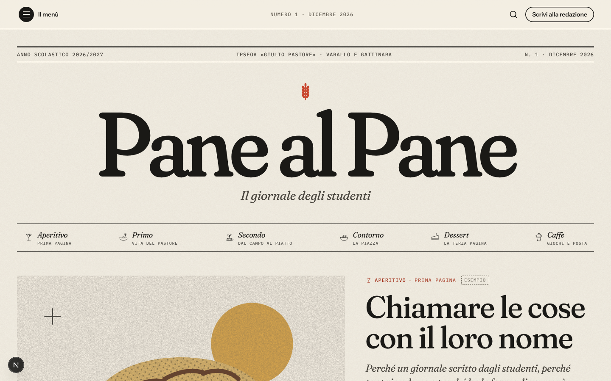
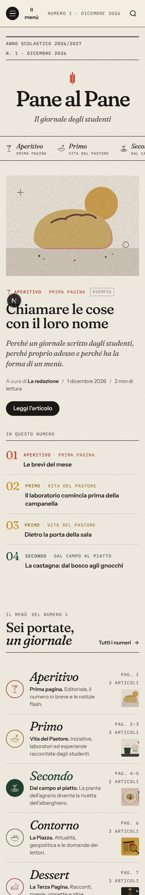
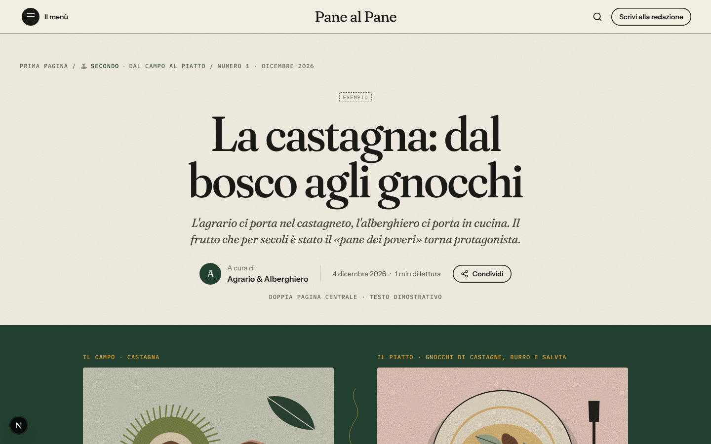
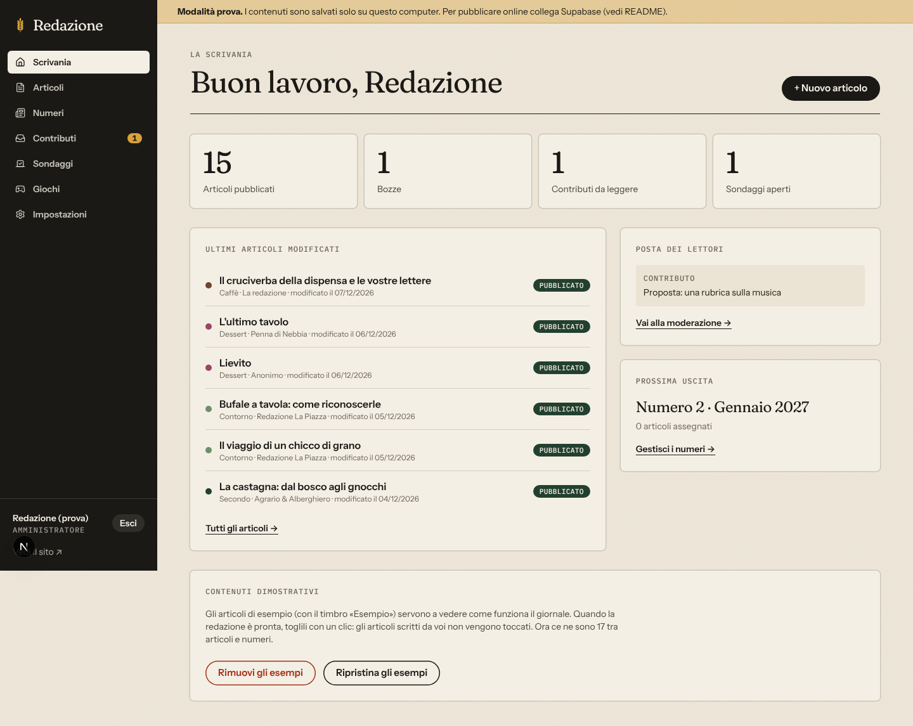
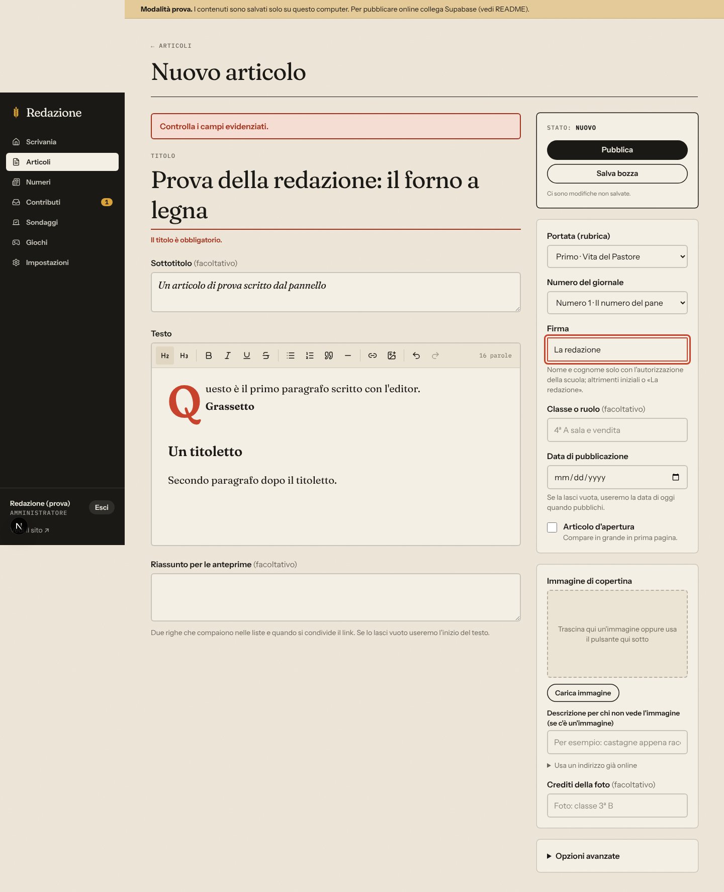
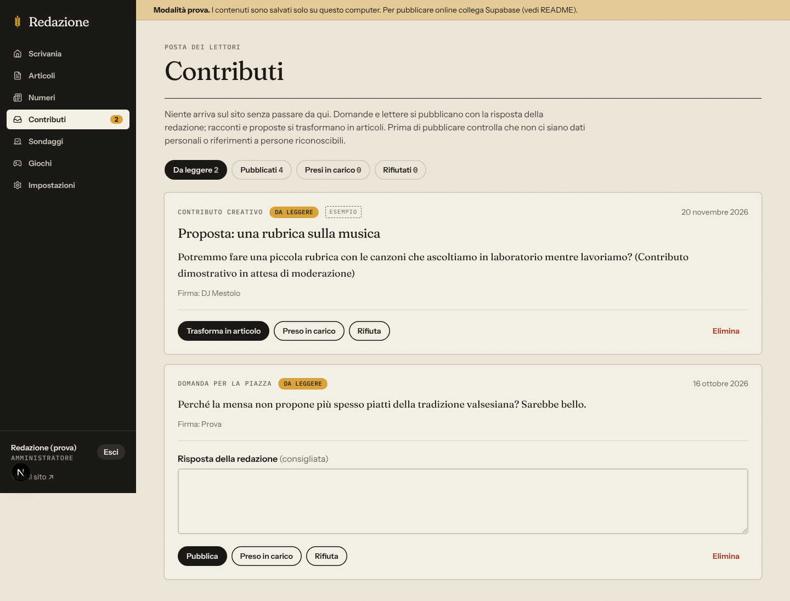

# Pane al Pane · Il giornale degli studenti

Piattaforma web del giornale scolastico dell'IPSEOA «Giulio Pastore» (sedi di Varallo e Gattinara).
Il giornale è impaginato come un menù: ogni portata è una sezione.

| Portata   | Sezione              | Indirizzo        |
| --------- | -------------------- | ---------------- |
| Aperitivo | Prima pagina         | `/menu/aperitivo` |
| Primo     | Vita del Pastore     | `/menu/primo`     |
| Secondo   | Dal campo al piatto  | `/menu/secondo`   |
| Contorno  | La Piazza            | `/menu/contorno`  |
| Dessert   | La Terza Pagina      | `/menu/dessert`   |
| Caffè     | Giochi e posta       | `/menu/caffe`     |

Tecnologie: Next.js 16 (App Router) + TypeScript, Tailwind CSS 4. Dati e accesso su **Neon** (PostgreSQL) con file su **Vercel Blob**, oppure tutto su **Supabase**: si sceglie con le variabili d'ambiente. Si pubblica gratis su Vercel.

---

## Schermate

I contenuti mostrati sono d'esempio, con dati inventati.



| Sito su telefono | Dal campo al piatto |
| --- | --- |
|  |  |

**Area redazione**







---

## 1. Provarlo sul proprio computer (5 minuti, senza account)

Serve [Node.js](https://nodejs.org) versione 20 o successiva.

```bash
npm install
cp .env.example .env.local
```

Apri `.env.local` e scrivi una password a tua scelta (almeno 8 caratteri):

```
LOCAL_ADMIN_PASSWORD=una-password-a-scelta
```

Poi:

```bash
npm run dev
```

- Sito: <http://localhost:3000>
- Redazione: <http://localhost:3000/redazione> (entra con la password appena scelta)

Senza `DATABASE_URL` e senza Supabase il sito funziona in **modalità prova**: contenuti e immagini vengono salvati nella cartella `.data/` del computer. Va benissimo per provare tutto (scrivere, pubblicare, moderare, votare), ma non per andare online. Per ricominciare da zero basta cancellare la cartella `.data/`.

## 2. Cosa c'è

**Sito pubblico**
- Prima pagina con testata, numero del mese, articolo d'apertura, menù interattivo delle sei portate, ultimi articoli, doppia pagina «Dal campo al piatto», Terza Pagina, domande dei lettori, sondaggio, giochi e archivio.
- Pagine delle sezioni con filtro per numero, pagine articolo pensate per la lettura (barra di avanzamento, condivisione, stampa della ricetta), impaginazione speciale per «Dal campo al piatto».
- Archivio dei numeri con PDF da sfogliare e scaricare, ricerca, cruciverba e quiz giocabili, sondaggi con risultati dopo il voto, modulo per scrivere alla redazione (sempre moderato).

**Area redazione** (`/redazione`, solo dopo l'accesso)
- Scrivania con riepilogo, ultimi articoli e posta in arrivo.
- Articoli: elenco con ricerca e filtri, editor di testo comodo (titoletti, grassetto, elenchi, citazioni, link, immagini con descrizione), bozza/pubblica/ritira, anteprima, eliminazione.
- Numeri: crea i sette numeri, carica copertina e PDF, decidi quando pubblicarli. Gli articoli di un numero non pubblicato restano nascosti.
- Contributi dei lettori: da leggere, pubblicati, presi in carico, rifiutati. Le domande si pubblicano con la risposta; racconti e proposte si trasformano in articoli.
- Sondaggi con risultati, giochi (cruciverba creato automaticamente da «PAROLA - definizione», quiz a scelta multipla).
- Impostazioni: nome della testata (è provvisorio: si cambia qui), scuola, testi del piè di pagina, ruoli della redazione.
- Pulsante per togliere tutti i contenuti dimostrativi quando si parte davvero.

Ogni modifica pubblicata compare subito sul sito.

## 3. Andare online

In breve:

**Con Neon e Vercel Blob** (guida in **[docs/SETUP-NEON.md](docs/SETUP-NEON.md)**): crea il progetto su Neon, `npm run db:migrate`, `npm run utente:crea`, poi pubblica su Vercel con `DATABASE_URL`, `SESSION_SECRET` e un archivio Blob collegato. Se `DATABASE_URL` è impostata, il sito usa Neon.

**Con Supabase (guida in **[docs/SETUP-SUPABASE.md](docs/SETUP-SUPABASE.md)**:**

1. Crea un progetto gratuito su Supabase ed esegui i tre file in `supabase/migrations/` nell'editor SQL.
2. Crea gli account della redazione e promuovi il primo amministratore.
3. Pubblica il codice su Vercel inserendo le due variabili di Supabase.

## 4. Sicurezza e privacy

- Nel codice non ci sono password né chiavi. I valori stanno solo in `.env.local` (ignorato da git) o nelle impostazioni di Vercel.
- **Con Neon** non ci sono regole nel database: i permessi di lettura sono applicati dal codice (`src/lib/store/neon.ts`, archivio dei lettori contro archivio della redazione) e le password sono salvate cifrate (scrypt). Le sessioni sono cookie firmati con `SESSION_SECRET`.
- **Con Supabase**, la chiave usata dal sito è quella pubblica: ciò che ognuno può fare è deciso dalle regole del database (Row Level Security, in `supabase/migrations/20261016000100_security.sql`). Un lettore può solo leggere i contenuti pubblicati, votare una volta e inviare un messaggio, che resta in attesa finché la redazione non lo approva.
- Chi si registra parte «in attesa» e non può modificare nulla finché un amministratore non gli assegna un ruolo.
- I voti sono anonimi (si salva solo un codice casuale, non l'indirizzo IP). Il modulo dei lettori non chiede email né telefono e rifiuta i messaggi che li contengono.
- Nomi completi e foto degli studenti vanno pubblicati solo secondo le autorizzazioni raccolte dalla scuola.

## 5. Contenuti dimostrativi

Articoli, numeri, sondaggi, giochi e messaggi d'esempio sono marcati «Esempio» e non raccontano fatti reali della scuola. Le illustrazioni in `public/demo/` sono disegni originali creati per questo progetto (vedi `public/demo/CREDITI.md`) e vanno sostituite con le foto della redazione. Si tolgono tutti insieme dalla Scrivania → «Rimuovi gli esempi».

## 6. Per chi mette mano al codice

```
src/app/(sito)/          pagine pubbliche
src/app/redazione/       area redazione e azioni del server
src/components/          componenti (site, interactive, admin)
src/lib/site.config.ts   nome provvisorio, portate, colori, calendario dei numeri
src/lib/store/           accesso ai dati: Neon, Supabase oppure file locale (modalità prova)
src/lib/demo/            contenuti dimostrativi
supabase/migrations/     tabelle, regole di sicurezza, spazio file (Supabase)
neon/migrations/         tabelle e funzioni (Neon): `npm run db:migrate`
scripts/                 migrazioni e creazione degli account (Neon)
```

Comandi utili: `npm run dev`, `npm run build`, `npm run lint`.

## Licenza e crediti

Il codice è distribuito con licenza **MIT** (file [LICENSE](LICENSE)): puoi usarlo, modificarlo e riutilizzarlo, mantenendo l'avviso di copyright.

- I caratteri (Fraunces, Instrument Sans, IBM Plex Mono) sono caricati da Google Fonts con licenza SIL Open Font License.
- Le illustrazioni in `public/demo/` sono disegni originali creati per il progetto (vedi [`public/demo/CREDITI.md`](public/demo/CREDITI.md)).
- Testi, fotografie e disegni che la redazione pubblica restano degli autori e della scuola: non sono coperti dalla licenza MIT.
- Le schermate in `docs/schermate/` mostrano dati inventati.
- La pagina **Crediti** del sito (`/crediti`) riporta gli stessi riconoscimenti.

Ideazione e struttura: Andrea Giardina.  
Progettazione e sviluppo: Simone Bruni ([LinkedIn](https://www.linkedin.com/in/simonebruni14/)).
